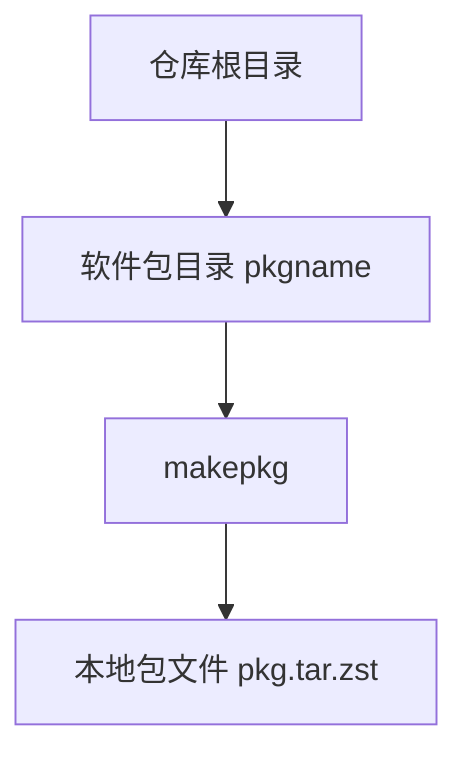

# aur_packages

严谨程度：项目说明。当前仓库尚未包含具体 PKGBUILD，下文描述的是本仓库的用途与约定目录结构，不表示已有可构建的软件包。

本仓库用于集中管理 Arch Linux 的 PKGBUILD 软件包定义，覆盖自维护包以及需要本地跟踪的 AUR 包。每个软件包占用一个独立目录，目录内保存构建所需的 `PKGBUILD`、`.SRCINFO` 以及补丁、安装脚本等附属文件。

## 用途

- 保存可复现的包构建配方，而不是保存已编译的二进制包。
- 用 Git 跟踪 `pkgver`、依赖、源码地址与校验和的变更。
- 在本机用 `makepkg` 构建，再按需安装或提交到 AUR。

## 目录结构

仓库根目录下，每个子目录对应一个软件包，目录名与 `pkgname` 一致：

```text
aur_packages/
├── README.md
└── <pkgname>/
    ├── PKGBUILD
    ├── .SRCINFO
    └── （可选）补丁、.install、桌面文件等
```



## 构建单个软件包

进入对应目录后构建。需要安装 `base-devel`，并确认 `PKGBUILD` 中的源码地址可访问：

```bash
cd <pkgname>
makepkg -si
```

常用选项：

| 选项 | 作用 |
| --- | --- |
| `-s` | 安装 `depends` 与 `makedepends` |
| `-i` | 构建完成后用 pacman 安装 |
| `-C` | 清理 `$srcdir` |
| `--verifysource` | 只校验源码，不构建 |

更新 AUR 包的元数据时，在软件包目录执行：

```bash
makepkg --printsrcinfo > .SRCINFO
```

## 约定

- 一个目录只对应一个 `pkgname`（split package 仍放在同一目录，由 `PKGBUILD` 内的 `pkgname` 数组声明）。
- 不把 `pkg/`、`src/`、以及 `*.pkg.tar.zst` 等构建产物提交进仓库。
- 上游源码通过 `PKGBUILD` 的 `source` 在构建时下载，不在本仓库内镜像完整上游树。
- 校验和、架构、许可与依赖必须写在 `PKGBUILD` 中，构建失败时直接暴露错误，不在仓库脚本里猜测缺失字段。

## 注意事项

- 本仓库目前没有自动化构建流水线；构建与安装在维护者本机完成。
- 向 AUR 发布时，使用 AUR 要求的 Git 远程与 `.SRCINFO`，不要把本仓库根目录直接当作单个 AUR 包仓库推送。
- Arch 官方仓库已提供的软件包，不应重复放进本仓库，除非有明确的本地补丁或打包差异需要跟踪。
