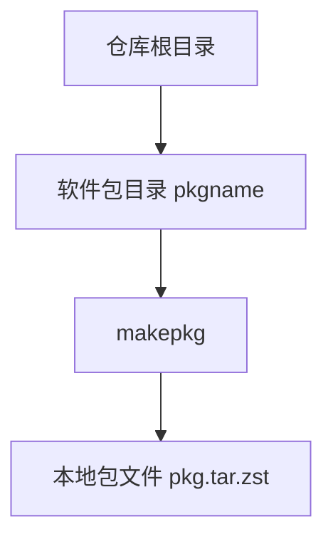

# aur_packages

严谨程度：项目说明。下文描述本仓库的用途、目录约定，以及当前已收录软件包。

本仓库用于集中管理 Arch Linux 的 PKGBUILD 软件包定义，覆盖自维护包以及需要本地跟踪的 AUR 包。每个软件包占用一个独立目录，目录内保存构建所需的 `PKGBUILD`、`.SRCINFO` 以及补丁、安装脚本等附属文件。

## 用途

- 保存可复现的包构建配方，而不是保存已编译的二进制包。
- 用 Git 跟踪 `pkgver`、依赖、源码地址与校验和的变更。
- 在本机用 `makepkg` 构建，再按需安装或提交到 AUR。

## 目录结构

仓库根目录下，每个子目录对应一个软件包，目录名与 `pkgname` 一致：

```text
aur_packages/
├── README.md
├── .gitignore
└── dagu-bin/
    ├── PKGBUILD
    ├── .SRCINFO
    ├── dagu-bin.install
    ├── dagu.service
    ├── dagu.sysusers
    ├── dagu.tmpfiles
    └── dagu.environment
```



## 已收录软件包

| 目录 | 版本 | 说明 |
| --- | --- | --- |
| `dagu-bin` | 2.7.4-1 | Dagu 工作流引擎的上游预编译二进制包，提供 `dagu`，与源码包 `dagu` 冲突 |

`dagu-bin` 从 [GitHub Releases](https://github.com/dagucloud/dagu/releases) 下载对应架构的 `tar.gz`，安装 `/usr/bin/dagu`、systemd 系统服务、sysusers/tmpfiles，以及 bash/zsh/fish 补全。默认 Web UI 地址见安装脚本提示：`http://127.0.0.1:8080`。配置文件为 `/etc/dagu/environment`（pacman backup），DAG 定义目录为 `/var/lib/dagu/dags/`。

## 构建单个软件包

进入对应目录后构建。需要安装 `base-devel`，并确认 `PKGBUILD` 中的源码地址可访问：

```bash
cd dagu-bin
makepkg -si
```

常用选项：

| 选项 | 作用 |
| --- | --- |
| `-s` | 安装 `depends` 与 `makedepends` |
| `-i` | 构建完成后用 pacman 安装 |
| `-C` | 清理 `$srcdir` |
| `--verifysource` | 只校验源码，不构建 |

更新 AUR 包的元数据时，在软件包目录执行：

```bash
makepkg --printsrcinfo > .SRCINFO
```

启用系统服务：

```bash
sudo systemctl enable --now dagu.service
```

## 约定

- 一个目录只对应一个 `pkgname`（split package 仍放在同一目录，由 `PKGBUILD` 内的 `pkgname` 数组声明）。
- 不把 `pkg/`、`src/`、以及 `*.pkg.tar.zst` 等构建产物提交进仓库。
- 上游源码通过 `PKGBUILD` 的 `source` 在构建时下载，不在本仓库内镜像完整上游树。
- 校验和、架构、许可与依赖必须写在 `PKGBUILD` 中，构建失败时直接暴露错误，不在仓库脚本里猜测缺失字段。

## 注意事项

- 本仓库目前没有自动化构建流水线；构建与安装在维护者本机完成。
- 向 AUR 发布时，使用 AUR 要求的 Git 远程与 `.SRCINFO`，不要把本仓库根目录直接当作单个 AUR 包仓库推送。
- Arch 官方仓库已提供的软件包，不应重复放进本仓库，除非有明确的本地补丁或打包差异需要跟踪。
